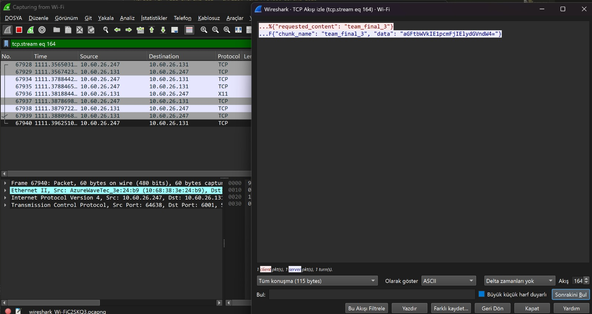
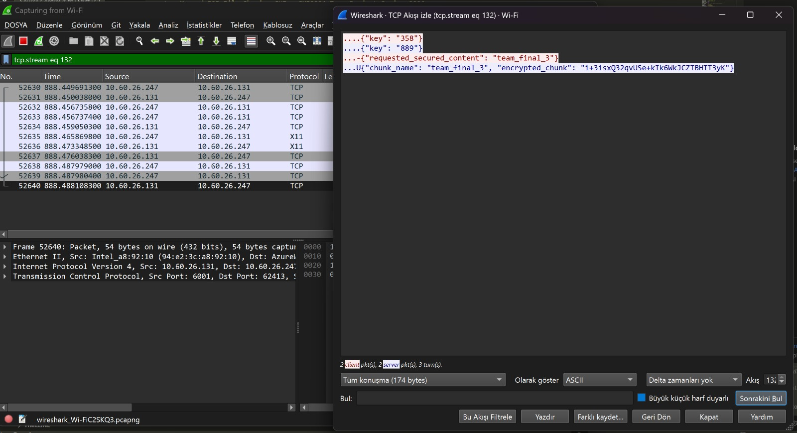

<div align="center">

# 🔐 Decentralized P2P File Sharing

**Share files across a local network with no server: peers find each other, split files into chunks, and send them encrypted.**


</div>

---

## 💡 Why this project exists

Most file sharing goes through a central server that can go down, be watched, or become a bottleneck. In a peer-to-peer system every computer is both a host and a downloader. This was the **CMP2204 term project**, built by a team called *The Randoms*: design a working P2P system on a local subnet, from discovery to secure transfer.

## 🔎 What it does

| Module | Protocol | Job |
|---|---|---|
| **Announcer** | UDP broadcast | Splits a file into exactly **3 chunks** and tells the network what you are hosting |
| **Discovery** | UDP (port 6000) | Listens for announcements and keeps a live list of available content |
| **Uploader** | TCP (port 6001) | Serves chunk requests from other peers |
| **Downloader** | TCP | Fetches the chunks, then merges them back into the original file |

- **Secure or plain transfer:** for each download you choose. Secure mode runs a **Diffie-Hellman key exchange** to create a shared secret, then encrypts each chunk with **DES-ECB** before it is sent.
- **Everything runs at once.** Each module lives in its own background thread, so the Tkinter window never freezes.
- **Automatic network setup.** The broadcast address is detected from your active network interface, with a manual override box.
- **Transfer history** is logged and viewable in the app.

### Proof that encryption works

The `docs/` folder holds two Wireshark captures of the same transfer: in plain mode the file contents are readable on the wire, and in secure mode they are not.

| Plain transfer | Encrypted transfer |
|:---:|:---:|
|  |  |

The full write-up is in [`docs/project-report.docx`](docs/project-report.docx).

## ⚙️ Setup

**Requirements:** Windows 10/11, Python 3.x, and one external library, `pyDes` (needed only for encrypted transfers). Everything else is in the standard library.

```bash
git clone https://github.com/MooreHaww/p2p-file-sharing.git
cd p2p-file-sharing
pip install -r requirements.txt
python p2p_app.py
```

**Using it**

1. **Network:** the broadcast address is detected automatically. If peers do not see each other, type your subnet broadcast address in the *Broadcast target* box (for example `192.168.1.255`, or `255.255.255.255`) and click **APPLY**.
2. **Announce a file:** click **ANNOUNCER**, enter a username and choose a file. It is split and announced.
3. **Start the uploader:** click **UPLOADER** to open the TCP server on port 6001.
4. **Start discovery:** click **DISCOVERY** to listen on UDP port 6000.
5. **Download:** wait about 5 to 8 seconds for the list to fill, click **DOWNLOADER**, then **VIEW AVAILABLE CONTENT**. Click **INITIATE DOWNLOAD**, type the file name (e.g. `team` or `team.txt`) and choose **Yes** for encrypted or **No** for plain transfer.

To test on one computer, run two copies from different folders.

## 🎯 What I wanted to learn

- How devices find each other with no server: UDP broadcast and periodic announcements.
- Why networking needs two protocols: UDP for cheap "who is out there" messages, TCP for reliable transfers.
- How to frame messages over TCP so a receiver always reads exactly the bytes sent.
- How a key exchange lets two strangers agree on a secret over an open network (Diffie-Hellman), and how that secret becomes a DES key.
- What encryption looks like on the wire, by comparing the two Wireshark captures.
- How to keep a GUI responsive while several network loops run in daemon threads.

## 🏗️ How it was built

Everything is in one file, `p2p_app.py` (about 860 lines), organised in sections.

- **Shared config:** ports, announce interval (8 s), expiry of stale peers (120 s), and automatic broadcast detection.
- **Helpers:** JSON load and save, exact-length socket reads, and length-prefixed send and receive.
- **Discovery:** a UDP listener thread plus a "wiper" thread that removes peers that stopped announcing.
- **Announcer:** splits the file into 3 chunks and broadcasts on a timer. More files can be added while it runs.
- **Uploader:** accepts TCP connections and serves chunks, running the key exchange for secure requests.
- **Downloader:** requests each chunk, decrypts it, logs the transfer, and merges the chunks into the original file.

The project was developed as a team, with the modules merged into this single application.

## 🗺️ Plan / what's next

- [x] Discovery, announcer, uploader and downloader working together
- [x] Diffie-Hellman key exchange with DES-encrypted chunks
- [x] Wireshark evidence for plain versus encrypted traffic
- [ ] Replace DES-ECB with AES in an authenticated mode (DES is obsolete, and ECB leaks patterns)
- [ ] Use real-size Diffie-Hellman parameters (the app uses a tiny prime, `907`, which is fine for learning but trivial to break)
- [ ] Download chunks from several peers in parallel
- [ ] Support any number of chunks and verify them with a hash
- [ ] Add Mac and Linux instructions

> ⚠️ This is a course project to learn how the pieces work. Do not rely on it to protect sensitive files.

## 📄 Notes

Built for CMP2204 by *The Randoms*. See [`docs/project-report.docx`](docs/project-report.docx) for the course report.
